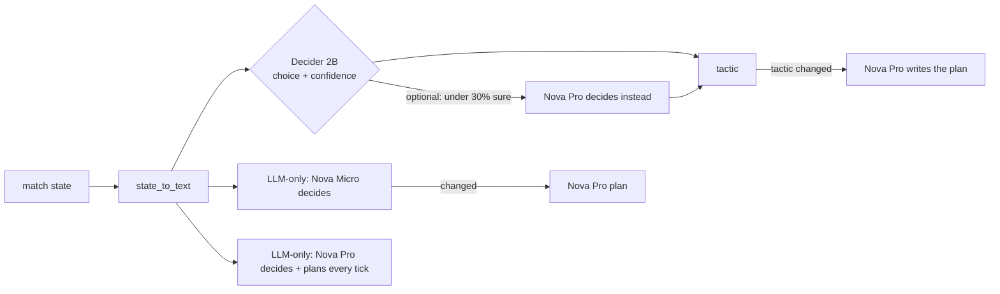

# MatchSense — Decider watches the match, Nova speaks when tactics change

`#strands-decider-2b` `#policy`

A five-a-side football tactical agent for the **AWS Agent Experience Hackathon: Strands Decider**.
Every 2-second tick, **Strands Decider 2B** classifies the match state into one of five tactical
policies with one typed `choice` question. **Amazon Nova** (on Amazon Bedrock, via Strands Agents)
writes a tactical plan **only when the policy changes** or Decider is unsure.

Inspired by AWS's Agentic Football Cup (independent of it: no game engine, scripted matches).
Built with the AWS User Group Madurai Strands Decider hackathon kit.

## The decision handed to Decider

> "Given the current five-a-side match situation, which tactical policy should the team follow next?"
> `HIGH_PRESS` · `COUNTERATTACK` · `KEEP_POSSESSION` · `PROTECT_LEAD` · `LOW_BLOCK`

The reusable pattern is in [`src/matchsense/policy_decision.py`](src/matchsense/policy_decision.py)
(labelled `REUSABLE DECISION PATTERN`) and explained in [`docs/DECISION_PATTERN.md`](docs/DECISION_PATTERN.md).
Decider never writes text; Nova writes the plan because a plan *is* text.



## Measured results (real run, 2026-10-23, `docs/results/bench_cli_20261023_233703.json`)

Our agent comes in two variants; both use Decider for the tactic and Nova Pro for the plan (written only
when the tactic changes). Compared with two LLM-only agents on the same 3 scripted matches (180 ticks,
173 labelled). Decider v19 local on an Apple M4 (MLX). The 30% bar and Nova Pro as the helper were chosen
on a separate set of 56 scenarios.

| | **Decider decides** | **Decider + Nova Pro when unsure** | Nova Micro decides every tick | Nova Pro decides + plans every tick |
|---|---|---|---|---|
| Accuracy vs our reference labels (n=173) | 69.4% | **80.3%** | 48.5% | 79.2% |
| Decision time p50 / p95 | **0.42 s** / 0.82 s | 0.97 s / 2.59 s | 0.99 s / 1.26 s | 4.09 s / 6.40 s |
| Decided within 1 s | **98%** | 50% | 55% | 0% |
| Bedrock calls / match | **15.3** | 44.7 | 78.3 | 60.3 |
| Bedrock cost / match | **$0.035** | $0.068 | $0.045 | $0.153 |

How to read it:
- **Decider decides** is the simplest and fastest option. It meets the 1-second deadline, needs about a quarter of the
  Bedrock calls, and costs ~77% less than the Nova-Pro-every-tick agent, at 10 points lower accuracy.
- **+ Nova Pro when unsure** hands the 47% of ticks where Decider is under 30% sure to Nova Pro.
  It matches the Nova-Pro-every-tick agent on accuracy (80.3% vs 79.2%) with 26% fewer Bedrock calls and 56% lower cost,
  but those handed-over ticks take ~2 s.
- If Nova Pro fails on a handed-over tick, Decider's pick is used, so the agent always has a tactic.
- Not included: Decider's own compute cost (local here; hosted is not free). Through the hosted API, the same
  Decider took ~2.4 s per call (earlier run). One trial per tick; labels are ours.

## Setup

```bash
python3.12 -m venv .venv && source .venv/bin/activate
pip install -r requirements.txt && pip install -e .
cp .env.example .env          # add DECIDER_API_KEY; AWS credentials via your normal AWS config
python scripts/build_data.py  # (re)generates data/ — already committed
python scripts/smoke_test_decider.py   # health check + real choice calls
python scripts/serve_local_decider.py  # optional: local Decider on Apple silicon (see the script for install), then DECIDER_MODE=local
python scripts/smoke_test_bedrock.py   # real Nova Micro + Nova Pro structured calls
```

Your AWS account needs Bedrock access to Amazon Nova Micro and Nova Pro in `AWS_REGION`
(`aws bedrock list-inference-profiles --region us-east-1` should list `us.amazon.nova-micro-v1:0` and
`us.amazon.nova-pro-v1:0`). Only Amazon Nova models are used.

## Run

```bash
uvicorn matchsense.server:app --reload       # http://localhost:8000
APP_MODE=mock uvicorn matchsense.server:app  # no AWS / Decider; banner: MOCK MODE — NOT A REAL MODEL RESULT
```

- **Match Replay:** pick a match and a baseline, **Run live** (SSE, real calls, real timing) or open a stored run for labelled recorded playback.
- **Match Lab:** edit any scenario (form or drag players on the pitch), run both flows on the same state, inspect the raw Decider exchange.
- **Benchmark:** run all flows on the same items, see metrics with n, charts, export CSV/JSON.

The server has **no authentication**; keep it on localhost (it spends your Bedrock and Decider quota).

## Test and benchmark

```bash
pytest -q                                              # 42 tests, all external services mocked
python scripts/run_benchmark.py --suites variants matches
python scripts/ui_check.py                             # headless check of the three tabs (needs playwright)
```

## Worked example (real output)

State text: *"The score is level at 1-1 with 1 minute 10 seconds left in a 2-minute match. We have the
ball around the halfway line. … One opposing outfield player is between the ball and their goal. Their
defence is out of position and there is open space in front of us. … Objective: exploit the open space quickly."*
Decider: `COUNTERATTACK`, confidence 0.913 (probabilities 0.930 / HIGH_PRESS 0.052 / …), ~2.4 s round trip.
Nova Pro then wrote one structured plan (1,260 in / 428 out tokens, $0.0024).

## Limitations

- Reference labels are rule-based and ours; scripted matches are not a simulation.
- Single trial per item; option wording was tuned on data overlapping the evaluation (see methodology).
- Hosted Decider latency (~2.4 s) is network/hosting; local MLX on an M4 was ~0.4 s. Ticks handed to Nova Pro take ~2 s.
- Plans are model-generated recommendations, not proven strategy.

## Layout

`src/matchsense/` (core) · `web/` (single page, SVG pitch, Chart.js from CDN) · `data/` · `scripts/` ·
`tests/` · `docs/` (architecture, pattern, methodology, article draft, video script, checklist, results).

License: Apache-2.0.
