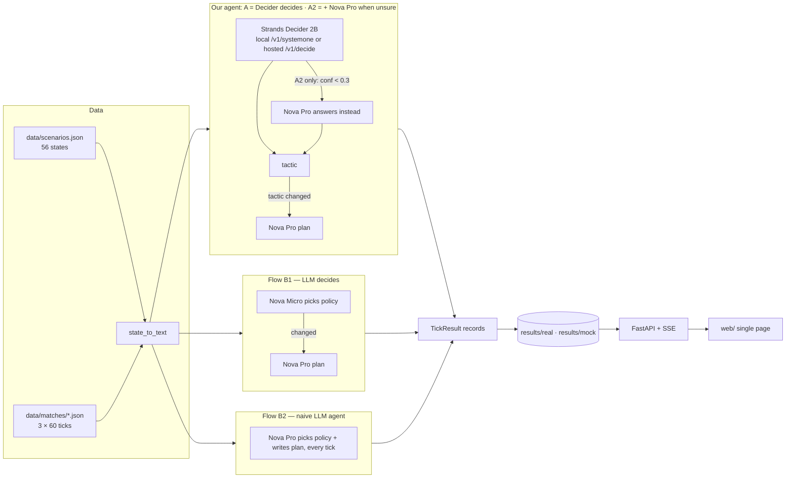

# Architecture

| Module | Role |
|---|---|
| `config.py` | settings from env / `.env`; `public()` never includes the key |
| `schemas.py` | `MatchState`, `DeciderResult`, `PolicyDecision`, `TacticalPlan`, `TickResult` |
| `state_text.py` | geometry → sentences, direction-normalised |
| `decider_client.py` | hosted Decider: `health()`, `decide_choice()`, typed errors, one keep-alive `httpx` session |
| `policy_decision.py` | the `#policy` pattern: question, options, threshold, fallback |
| `bedrock_client.py` | Strands `Agent` + `BedrockModel`, Pydantic structured output, token usage, cost |
| `tactical_planner.py` | Nova Micro chooser, Nova Pro planner, Nova Pro choose-and-plan (B2) |
| `hybrid_flow.py`, `baseline_flow.py` | our agent (A "Decider decides", A2 "+ Nova Pro when unsure") and the LLM-only baselines B1, B2 |
| `decider_gate.py` | the same pattern as a Strands `InterventionHandler` (`Deny` the planner when the policy is unchanged) |
| `replay.py` | plays a match through the lanes, same text per tick, lanes in parallel |
| `benchmark_runner.py`, `metrics.py` | trials → rows → summary, CSV/JSON |
| `persistence.py`, `jobs.py` | stored runs (real/mock folders), background jobs |
| `server.py` | API, SSE stream, static frontend |
| `mock.py` | `APP_MODE=mock` fixtures, labelled "NOT A REAL MODEL RESULT" |

Only Amazon Nova models are used on Bedrock (Nova Micro and Nova Pro, cross-region `us.` inference
profiles in us-east-1). Decider runs on the AWS User Group Madurai hosted decision cloud.

Security: the server has **no authentication** and is meant for localhost. Anyone who can reach it can
spend your Bedrock and Decider quota. Do not expose it publicly without adding auth.
