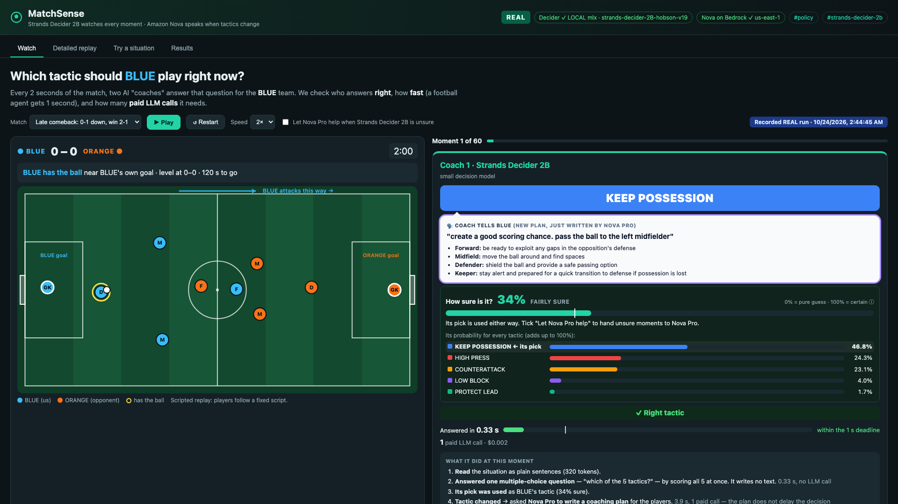
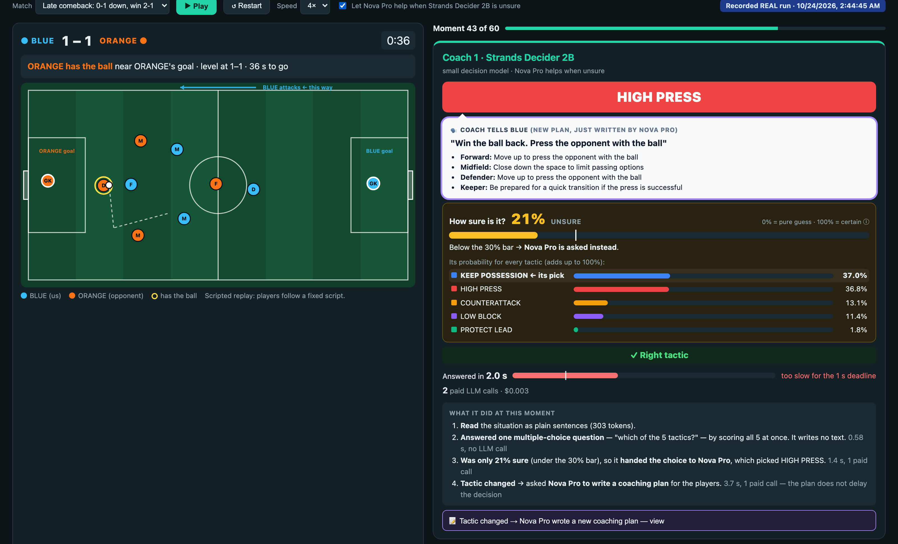

# MatchSense: Strands Decider 2B decides every moment, Amazon Nova on Bedrock speaks only when tactics change

**Tags:** `#strands-decider-2b` `#policy`

**Repo:** https://github.com/Poobalan1210/agentic-football · **Demo video:** https://youtu.be/6mdD8ozuak0

[](https://youtu.be/6mdD8ozuak0)

*▶ Watch the 2:34 demo on YouTube: https://youtu.be/6mdD8ozuak0*

**TL;DR**

- **The decision handed to Strands Decider 2B:** at every 2-second moment of a five-a-side football match, one typed `choice` question picks the team's tactic from five options. Pattern: **`#policy`**.
- **The generative part:** Amazon Nova Pro on Amazon Bedrock (through Strands Agents) writes a coaching plan only when the tactic changes, about 15 times per match instead of 60.
- **Measured on 3 scripted matches (173 labelled moments):** Decider alone decided within 1 second on every moment (median 0.37 s) at 77% lower Bedrock cost than an LLM-only Nova Pro agent. Handing Decider's unsure moments to Nova Pro gave the best accuracy, 82.1% vs 79.2%, at 56% lower cost.
- **Reusable:** the decision ships as a Strands `InterventionHandler` that denies the LLM call before Bedrock whenever the policy hasn't changed.

## The problem: an LLM at every moment

In AWS's Agentic Football Cup, teams of five autonomous agents make decisions every two seconds. I gave each decision a 1-second budget, so the agent can act well inside the 2-second window. The obvious way to build that agent is to give the state to a large language model at every point and ask it what to do. Over a two-minute match that's 60 large-model calls, and most of them come back with "keep doing what you're doing". It's also too slow: in my runs Amazon Nova Pro took about 4 seconds per answer, so it missed every 1-second deadline.

I wanted to test one claim and report the results whichever way they went:

> *A small decision model can re-decide the team's tactic at every moment, and the generative model only needs to speak when the tactic actually changes.*

**MatchSense** is a five-a-side football tactical agent built around that idea. **Strands Decider 2B** acts as the team's *instinct*: at every moment it answers one multiple-choice question. **Amazon Nova Pro** on Amazon Bedrock is the *coach's voice*: it writes a coaching plan only when the instinct says the tactic has changed.

## How this relates to the Agentic Football Cup

MatchSense is inspired by the Cup but independent of it: it doesn't run on the Cup's game or compete in it. I took the Cup's 2-second rhythm and asked what happens if the LLM call made at every moment is handed to Strands Decider 2B instead.

| | Agentic Football Cup | MatchSense |
|---|---|---|
| Timing | decisions every 2 seconds | **same 2-second rhythm**: 60 moments per 2-minute match. The 1-second deadline per decision is my own budget, not a Cup rule |
| The match | a live game | **scripted** five-a-side matches (3 × 60 moments with goals, turnovers, a late comeback and a protected lead). Players follow the script and don't react to the decisions |
| What is decided | the agent's actions in the game | **the team tactic only** (one of five), plus a written coaching plan when it changes. Nothing moves players |
| How it's judged | the match result | an **answer key** I wrote: a rule-based correct tactic for each moment, so every agent is scored on the same moments |

Scripted matches are what make the comparison fair. All four agents see exactly the same 180 moments with the same state text, so differences in accuracy, speed and cost come from the agent, not from how a game happened to unfold. The cost is realism: a scripted opponent never punishes a wrong tactic.

## The decision handed to Decider 2B

At every moment, the agent asks Decider one typed `choice` question:

> *"Given the current five-a-side match situation, which tactical policy should the team follow next?"*

| Option | When it applies |
|---|---|
| `HIGH_PRESS` | the opponent has the ball deep in their own half, far from our goal, and we press them high up the pitch to force a turnover |
| `COUNTERATTACK` | we have just won the ball and their defence is out of position, so we attack the open space at speed |
| `KEEP_POSSESSION` | we have the ball but their defenders are in place, so we pass safely and build patiently |
| `PROTECT_LEAD` | we are ahead near the end of the match, so we take no risks and run down the clock |
| `LOW_BLOCK` | the opponent has the ball in our half or is breaking towards our goal, so we drop deep, protect the centre and break out with controlled transitions |

Decider answers in one forward pass with a probability for every option and its own confidence score. It never writes text. Nova Pro writes the plan, because a plan *is* text.

### Why this is the `#policy` pattern

Each moment's match state is the incoming request. Before the agent does anything, Decider classifies it into one of five named policies, and that policy decides what happens next: whether a new coaching plan is needed, and what the plan must say. The decision is *which way of playing fits this situation*. It is not which tool to call, which model to use, or whether something is allowed.

Two features could look like other patterns, but both follow from the policy decision:

- **Nova Pro taking over when Decider is unsure** looks like model routing. It is a fallback *for the policy decision*: the question and options stay the same, and only who answers changes when Decider's own confidence is low. Decider alone, with no helper at all, is a complete agent.
- **Denying the LLM call when nothing changed** looks like a guardrail. Nothing is being blocked for safety: the call is skipped because the policy is unchanged, so the current plan is still valid.

## How one moment works

1. **The state becomes sentences.** A 2B model is weak at geometry from raw coordinates, so code computes the facts and writes them out: *"One opposing outfield player is between the ball and their goal. Their defence is out of position and there is open space in front of us."* The direction of attack is normalised, so attacking left and attacking right produce identical text (this is tested).
2. **Decider picks the tactic.** One `choice` question, with the five definitions above.
3. **Optional: Nova Pro takes over when Decider is unsure.** If Decider's own confidence is below 0.30, Nova Pro answers the same question from the same text. Both answers are recorded.
4. **Nova Pro writes a plan only when the tactic changes.** The plan is structured output (Pydantic, through Strands Agents `BedrockModel`): goalkeeper instruction, one instruction per outfield role, immediate actions, main risk and mitigation, and signals to reassess. If nothing changed, the current plan stays and Bedrock is not called.



*The Watch tab replaying a recorded real run. Coach 1 is Strands Decider 2B: its pick, how sure it is, and how it weighed all five tactics. Coach 2, below, is Nova Pro asked at every moment.*

## A real moment from the recorded run

*Late comeback, 0–1 down, 40 seconds left.* Two moments earlier we won the ball with open space ahead. Decider switched to `COUNTERATTACK` (86% confident), and that switch triggered **exactly one** Nova Pro plan. At this moment Decider says `COUNTERATTACK` again, confidence 0.87, in **0.42 s**, with **zero Bedrock calls**. The LLM-only agent picked the same tactic, but took 3.8 s and rewrote the whole plan, as it had on all 41 moments so far.

### What each model received and returned at the switch

**Strands Decider 2B: the complete request**, as sent at the switch (`POST /v1/systemone` on the local server; the hosted API takes the same body at `/v1/decide`):

```json
{
  "state": "We are losing 0-1 with 44 seconds left in a 2-minute match. We have the ball in our own half, 14 m from our goal. We won the ball back just now. One opposing outfield player is between the ball and their goal. Their defence is out of position and there is open space in front of us. All our team-mates are marked. We have no open passing options. Three opponents are within 6 m of the ball. Their outfield players are pushed up, leaving space behind them. Our players are moderately tired. Objective: exploit the open space quickly.",
  "questions": {
    "policy": {
      "type": "choice",
      "instructions": "Given the current five-a-side match situation, which tactical policy should the team follow next?",
      "criteria": {
        "HIGH_PRESS": "the opponent has the ball deep in their own half, far from our goal, and we press them high up the pitch to force a turnover",
        "COUNTERATTACK": "we have just won the ball and their defence is out of position, so we attack the open space at speed",
        "KEEP_POSSESSION": "we have the ball but their defenders are in place, so we pass safely and build patiently",
        "PROTECT_LEAD": "we are ahead near the end of the match, so we take no risks and run down the clock",
        "LOW_BLOCK": "the opponent has the ball in our half or is breaking towards our goal, so we drop deep, protect the centre and break out with controlled transitions"
      }
    }
  }
}
```

**The complete answer** (the fields we record):

```json
{
  "choice": "COUNTERATTACK",
  "confidence": 0.8557,
  "probabilities": {"HIGH_PRESS": 0.0979, "COUNTERATTACK": 0.8846, "KEEP_POSSESSION": 0.0076,
                    "PROTECT_LEAD": 0.0048, "LOW_BLOCK": 0.0051},
  "input_tokens": 333,
  "server_latency_ms": 359.82,
  "round_trip_ms": 361.3
}
```

**Amazon Nova Pro: the plan call (shortened)**, made only because the tactic changed. The system prompt asks for a short, concrete plan for a five-a-side team that follows the given policy exactly. The message is the same state text, then:

```text
POLICY TO FOLLOW: COUNTERATTACK (we have just won the ball and their defence is out of position, so we attack the open space at speed)

Write the tactical plan. Its `policy` field must be COUNTERATTACK.
```

It returns a structured `TacticalPlan` (shortened here; the full plan has 11 fields):

```json
{
  "policy": "COUNTERATTACK",
  "tactical_objective": "exploit the open space quickly",
  "goalkeeper_instruction": "be prepared for a potential quick counter from the opponents",
  "outfield_instructions": [
    {"role": "MID_LEFT", "instruction": "advance quickly into the open space"},
    {"role": "FWD", "instruction": "be ready to capitalize on any opportunities created"}
  ],
  "main_risk": "opponents may recover quickly and counter",
  "mitigation": "maintain awareness of opponent positions"
}
```

The same moment, by size:

| | Decider (tactic) | Nova Pro (plan, only on a change) | LLM-only Nova Pro (every moment) |
|---|---|---|---|
| Input tokens | 333 | 1,258 | 1,427 |
| Output | 1 choice + 5 probabilities, no text | 338 tokens of JSON | 416 tokens of JSON |
| Time | 0.36 s | 3.9 s | 3.9 s |
| Bedrock cost | none (Decider ran locally) | $0.0021 | $0.0025 |
| How often per match | every moment (60) | 15 | every moment (60) |

Nova's prompt text is short. Most of its input tokens are the plan's output schema, which Strands sends with the call to get structured output. The complete prompts and outputs for every moment are in the app's *"See exactly what each model received and returned"* panel and in the committed run files (`docs/results/replays/`).

With 36 seconds left, two moments after that, Decider gets one wrong: it says `KEEP_POSSESSION` where the answer key says `HIGH_PRESS`. It is also only 21% confident, which is below the bar, so the *"Nova Pro when unsure"* variant handed that moment to Nova Pro, which said `HIGH_PRESS`. That is the point of a decision model reporting its own confidence: the agent can tell when to doubt it.



*Decider was split almost evenly between two tactics (37.0% vs 36.8%), so its confidence was only 21%. Below the 30% bar, Nova Pro decided instead and got it right. The price is visible too: 2.0 s and two paid calls for that moment.*

## Measured results

**Final run** (2026-10-24): 3 scripted matches, 180 moments, 173 with an answer key. Decider v19 running locally on an Apple M4 (MLX); Amazon Nova on Bedrock, us-east-1; one trial. The 0.30 threshold and Nova Pro as the helper were chosen on a *separate* set of 56 scenarios, not on these matches.

| | **Decider decides** | **Decider + Nova Pro when unsure** | Nova Micro decides every moment | Nova Pro decides + plans every moment |
|---|---|---|---|---|
| Right tactic (vs. answer key) | 69.4% | **82.1%** | 48.6% | 79.2% |
| Decision time, p50 | **0.37 s** | 0.76 s | 1.01 s | 3.98 s |
| Decided within 1 s | **100%** | 53% | 42% | 0% |
| Bedrock calls per match | **15.7** | 44.7 | 79.3 | 60.7 |
| Bedrock cost per match | **$0.036** | $0.068 | $0.048 | $0.154 |


This gives two trade-offs, not one winner:

- **Decider decides** is the fast, cheap instinct. It met the 1-second deadline on every moment, used about a quarter of the Bedrock calls and cost **77% less** than the Nova-Pro-every-moment agent. The price is 10 points lower accuracy.
- **Decider + Nova Pro when unsure** hands the 47% of moments where Decider is under 30% sure to Nova Pro. It was **more accurate than the LLM-only agent (82.1% vs 79.2%) at 56% lower cost**, but those handed-over moments take about 2 s.
- **Decider's confidence is a usable signal.** When it was 30% sure or more, Decider was right 85% of the time; below that, 49%. The LLM-only agents gave no comparable measured signal.
- **On the same question, Decider 2B beat Nova Micro by 21 points.**

**Both test sets together** (the Results screen shown in the demo video): the same run on the 3 matches plus the 56 separate scenarios, 236 decisions per agent, 228 with an answer key. Calls per match don't apply to the scenarios, so cost is per 1,000 decisions.

| | **Decider decides** | **Decider + Nova Pro when unsure** | Nova Micro decides every moment | Nova Pro decides + plans every moment |
|---|---|---|---|---|
| Right tactic (vs. answer key) | 70.6% | **82.0%** | 47.8% | 75.9% |
| Decision time, p50 | **0.38 s** | 0.72 s | 1.01 s | 3.94 s |
| Decided within 1 s | **99.6%** | 56% | 43% | 0% |
| Bedrock cost per 1,000 decisions | **$1.04** | $1.51 | $1.18 | $2.56 |

The picture is the same: Decider alone is the fastest and cheapest, and Decider with Nova Pro on unsure moments is the most accurate.

These numbers leave things out, and here is what: Decider's own compute cost is not included (it ran locally here, and hosting it is not free). The answer keys are rule-based and written by me. Through the hosted Decider API the same model took about 2.4 s per call from my laptop in India, so where the decision model runs decides whether it can meet a 1-second deadline.

## What went wrong first

Every one of these is in the repo's run history (`docs/BENCHMARK_METHODOLOGY.md`).

- **Action-only option text sent Decider one way.** My first definitions described actions ("pressure the opponent high up the pitch…"), and Decider picked `COUNTERATTACK` for almost every state where we had the ball: 18 of 57 right on a probe set. Rewriting each option as *"when [condition], so we [action]"* raised that to 30 of 57, and adding computed facts to the state text ("their defence is set", "they are attacking towards our goal") raised it to 42 of 57. The problem was mostly my question, not the model. *Caveat:* that probe was drawn from the same scenarios and matches I later evaluated on, so treat Decider's own accuracy as somewhat optimistic.
- **A 0.70 threshold turned the hybrid into Nova Micro.** With five close options, Decider's confidence was below 0.70 on 91% of decisions, so the cheap helper answered almost everything. The hybrid scored 44.7%, about Nova Micro's level (44.3%) and far below Decider's own 70.6% in the same run. The calibration table showed the wrong answers cluster below 0.2 confidence, and a threshold sweep on the separate set of 56 scenarios picked 0.30.
- **A weak helper lowers accuracy.** At 0.30 with Nova Micro as the helper, the hybrid still scored *below* Decider alone on the matches (67.0% vs 69.4%). On the scenario set, Nova Pro as the helper reached 80.4%, against 73.2% for no helper and 71.4% for Nova Micro, so Nova Pro became the helper.
- **My first hybrid made more Bedrock calls than the LLM-only agent.** Each hand-over cost a Nova Micro call, *and* it wrote a new Nova Pro plan after every hand-over even when the tactic stayed the same (33.7 plans per match). The total was 62.0 Bedrock calls per match, against 60.3 for Nova Pro at every moment. Planning only when the tactic actually changes cut it to 15.7 (Decider alone) and 44.7 (with Nova Pro helping).
- **The hosted Decider missed every deadline.** Through the hosted API the round trip was about 2.4 s from my laptop (about 2.0 s on the server), and it queued concurrent requests. Running the same model locally on an Apple M4 brought it to about 0.4 s.
- **Nova Micro's structured output broke.** In the first run it failed 20 times: malformed tool calls and a 150-token output cap that cut answers off. Raising the cap to 400 and retrying once on that specific error fixed it, and the retries are counted in the call and cost numbers.

## The reusable pattern: one Strands InterventionHandler

The hackathon asks for a reusable Decider 2B decision pattern in three parts. Here is where each one is:

| Required part | In this repo |
|---|---|
| **The typed question and option set** | `QUESTION` and `POLICY_OPTIONS` in [`policy_decision.py`](https://github.com/Poobalan1210/agentic-football/blob/HEAD/src/matchsense/policy_decision.py): one `choice` question and five options, each written as *"when [condition], so we [action]"* (shown in full above) |
| **The wiring that puts the decision in the agent's path** | `DeciderPolicyGate` in [`decider_gate.py`](https://github.com/Poobalan1210/agentic-football/blob/HEAD/src/matchsense/decider_gate.py), a Strands `InterventionHandler` that runs before every model call |
| **A short note on how to use it** | [`docs/DECISION_PATTERN.md`](https://github.com/Poobalan1210/agentic-football/blob/HEAD/docs/DECISION_PATTERN.md), plus the steps below |

Declared pattern: **`#policy`**. Each moment's state is the incoming request, and Decider classifies it into a policy before the agent acts.

The pattern ships in two forms. `policy_decision.py` is a plain function: question, options, confidence gate and fallback. `decider_gate.py` packages the same decision as a Strands **`InterventionHandler`**, so any Strands agent gets "Decider decides, the LLM speaks only when the policy changes" with one line:

```python
from strands import Agent
from strands.models import BedrockModel
from matchsense.decider_client import DeciderClient
from matchsense.decider_gate import DeciderPolicyGate
from matchsense.policy_decision import QUESTION, POLICY_OPTIONS    # or your own question + options
from matchsense.tactical_planner import PLANNER_SYSTEM

gate = DeciderPolicyGate(DeciderClient(), QUESTION, POLICY_OPTIONS)
planner = Agent(model=BedrockModel(model_id="us.amazon.nova-pro-v1:0"),
                system_prompt=PLANNER_SYSTEM, interventions=[gate])

result = planner("Write the plan.", invocation_state={"state_text": state_text})
```

In `before_invocation`, before any model call, the gate asks Decider the question:

- **The policy is unchanged and a plan already exists for it:** it returns `Deny`, and the agent stops before calling Bedrock (0 tokens).
- **The policy changed:** it returns `Transform`, putting the chosen policy and its definition at the top of the message so the LLM writes for that policy.
- **Decider is unsure** (optional `unsure_below`): the LLM is told so, given Decider's ranking, and decides itself.
- **The plan call failed:** the policy only counts as planned after a successful model call, so the next invocation retries.

In a real 12-moment run (`scripts/gate_demo.py`), the gated Nova Pro agent made **2 planner calls and was denied 10 times before Bedrock**, at about 0.3 s for each Decider check.

**How to use it in your own agent** (here, support-ticket triage):

1. Write one question and a few mutually exclusive options, each as *"when [condition], so we [action]"*.
2. Turn your state into plain sentences in code, and pass them in `invocation_state`.
3. Add the gate to your Strands agent. The LLM is then called only when the policy changes.
4. Measure Decider's calibration on your own data before setting `unsure_below`.

```python
QUESTION = "Which handling policy fits this support ticket?"
OPTIONS = {"self_serve": "the answer is in the docs, so we reply with a link",
           "escalate":   "money or data is at risk, so a human takes over",
           "clarify":    "the request is ambiguous, so we ask one question"}

gate = DeciderPolicyGate(DeciderClient(), QUESTION, OPTIONS, state_key="ticket_text")
agent = Agent(model=BedrockModel(model_id="us.amazon.nova-pro-v1:0"), interventions=[gate])
agent("Reply to the customer.", invocation_state={"ticket_text": render(ticket)})
```

This exact setup, with support-ticket options, is covered by a test in the repo (`tests/test_decider_gate.py`).

## Try it

```bash
git clone https://github.com/Poobalan1210/agentic-football && cd agentic-football
python3.12 -m venv .venv && source .venv/bin/activate
pip install -r requirements.txt && pip install -e .
APP_MODE=mock uvicorn matchsense.server:app     # no keys needed: plays the committed real runs
```

Open http://localhost:8000. The **Watch** tab replays a recorded real match with the two coaches side by side. **Try a situation** lets you drag players around and run both agents on the same state. **Results** shows the full benchmark, the calibration table and a threshold sweep. To run it live, set `APP_MODE=real` with Amazon Bedrock access to Amazon Nova Micro and Nova Pro in your AWS account, and a Strands Decider endpoint: either the AWS User Group Madurai hosted Decider used in this hackathon (`DECIDER_MODE=hosted` plus your key; about 2.4 s per call from India in my runs, so it misses a 1-second deadline) or the same model on your own machine (`DECIDER_MODE=local`, about 0.4 s on an Apple M4; see `scripts/serve_local_decider.py`). The app has no login, so keep it on localhost.

**Stack:** Strands Decider 2B · Strands Agents (`BedrockModel`, structured output, `InterventionHandler`) · Amazon Nova Pro and Nova Micro on Amazon Bedrock · FastAPI with Server-Sent Events · a single HTML page with a hand-built SVG pitch · 64 tests with every external service mocked.

## What I'd try next

Let the "Nova Pro when unsure" variant act on Decider's pick *immediately* and let Nova Pro correct it on the next moment, instead of making that moment wait about 2 s. It should meet the 1-second deadline almost as often as Decider alone while keeping most of the accuracy gain, but that needs a new benchmark run.

## Lessons

1. Keep the decision model's job narrow: one question, with mutually exclusive options written as conditions.
2. Turn the state into plain sentences in code. Don't make a 2B model do the geometry.
3. Measure calibration before choosing a threshold, and choose it on a different split from the one you report.
4. A cheap fallback doesn't add accuracy for free. A weak one can pull the hybrid below the decision model alone.
5. Where the decision model runs determines its latency, so measure it where it will actually run.
6. Count every LLM call, including hand-overs and retries. A hybrid can quietly cost more than the agent it replaces.

*Plans are model-generated recommendations, not proven strategy. Matches are scripted; players don't react to the decisions.* Inspired by AWS's Agentic Football Cup (independent of it). Built with the AWS User Group Madurai Strands Decider hackathon kit. Strands Decider and Strands Agents are Apache-2.0; this project is Apache-2.0.

## Sources and assumptions

- **About the Agentic Football Cup:** what this article says about the Cup (teams of five autonomous agents making decisions every two seconds, built with Amazon Bedrock and the Strands Agents SDK) comes from AWS's public event pages, for example [AWS Startups: Agentic Football Cup](https://startups.aws.com/events/agentic-football-cup-gurgaon-build-ai-agents-that-play-football). MatchSense does not use the Cup's game, rules engine or code, and is not affiliated with or endorsed by the Cup.
- **The 1-second deadline is mine.** I chose it as a budget inside the Cup's 2-second rhythm. It is not an official Cup rule.
- **Everything else is measured or written by me:** the scripted matches, the answer key, and every benchmark number, from the stored runs in the repo.

## Resources

**This project**

- 🎬 **Demo video (2:34):** https://youtu.be/6mdD8ozuak0
- 💻 **GitHub repo:** https://github.com/Poobalan1210/agentic-football
- 🧩 **Reusable pattern, Strands wiring:** [`src/matchsense/decider_gate.py`](https://github.com/Poobalan1210/agentic-football/blob/HEAD/src/matchsense/decider_gate.py) (`DeciderPolicyGate`, a Strands `InterventionHandler`)
- 🧩 **Reusable pattern, plain function:** [`src/matchsense/policy_decision.py`](https://github.com/Poobalan1210/agentic-football/blob/HEAD/src/matchsense/policy_decision.py)
- 📘 **How to reuse the pattern:** [`docs/DECISION_PATTERN.md`](https://github.com/Poobalan1210/agentic-football/blob/HEAD/docs/DECISION_PATTERN.md)
- 📊 **Benchmark method and every run, including the failed ones:** [`docs/BENCHMARK_METHODOLOGY.md`](https://github.com/Poobalan1210/agentic-football/blob/HEAD/docs/BENCHMARK_METHODOLOGY.md)
- 🗂️ **Raw results of the final run:** [`docs/results/bench_cli_20261024_023923.json`](https://github.com/Poobalan1210/agentic-football/blob/HEAD/docs/results/bench_cli_20261024_023923.json) (every moment, every agent), plus the recorded matches in [`docs/results/replays/`](https://github.com/Poobalan1210/agentic-football/tree/HEAD/docs/results/replays)
- ▶️ **Gate demo script:** [`scripts/gate_demo.py`](https://github.com/Poobalan1210/agentic-football/blob/HEAD/scripts/gate_demo.py)

**Tools and models used**

- **Strands Decider:** https://github.com/strands-labs/strands-decider (the [inference docs](https://github.com/strands-labs/strands-decider/blob/main/docs/inference.md) cover the typed `choice` question)
- **Strands Agents SDK:** https://strandsagents.com/
- **Amazon Bedrock pricing** (the Nova Micro and Nova Pro prices used for the cost numbers): https://aws.amazon.com/bedrock/pricing/
- **The hackathon:** [AWS Agent Experience Hackathon: Strands Decider](https://builder.aws.com/build/hackathons/4f50957c-1d08-37ab-b11c-97516b9adeb4/agent-experience-hackathon-strands-decider)

License: Apache-2.0.

`#strands-decider-2b` `#policy`
